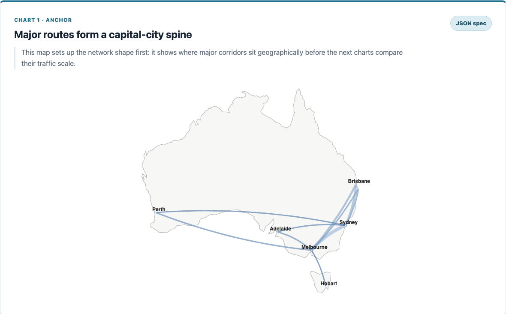

# Chenglin Li

[中文项目作品集 PDF](assets/Chenglin-Li-Portfolio-ZH.pdf) · Five illustrated project briefs, with source and demo links.

## Australia in Flight

Explore which routes carry the most passengers, how domestic traffic changed over time, and how airport traffic compares with city population. The story includes 15 interactive maps and charts built with Vega-Lite. [Open the live visualisation](https://kkent777.github.io/fit2179-dv2/) · [Explore the data and source](https://github.com/Kkent777/fit2179-dv2)

## More projects

| Project | What to explore |
| --- | --- |
| [FootballGame](https://github.com/Kkent777/FootballGame) | An Unreal Engine 5.5 football prototype. Follow a charged shot from the [player input code](https://github.com/Kkent777/FootballGame/blob/main/Source/FootballGame/FootballGameCharacter.cpp) to [goal detection and respawn](https://github.com/Kkent777/FootballGame/blob/main/Source/FootballGame/Goal.cpp). |
| [MedTrackPro](https://github.com/Kkent777/MedTrackPro) | A Kotlin and Jetpack Compose app with fictional patient records. Trace a medication or symptom entry from a screen through a ViewModel to a Room database. |
| [Smart Water Reminder](https://github.com/Kkent777/Smart-Water-Reminder) | A handheld micro:bit V2 reminder. [See the enclosure build](https://github.com/Kkent777/Smart-Water-Reminder#making-the-enclosure) and [read the MakeCode source](https://github.com/Kkent777/Smart-Water-Reminder/blob/main/main.ts). |
| [Android Skills](https://github.com/Kkent777/Android-Skills) | Nine Android development guides in Chinese. [Start with the development guide](https://github.com/Kkent777/Android-Skills/blob/main/skills/android-app-development/SKILL.md), then explore Compose state, data or performance. |
